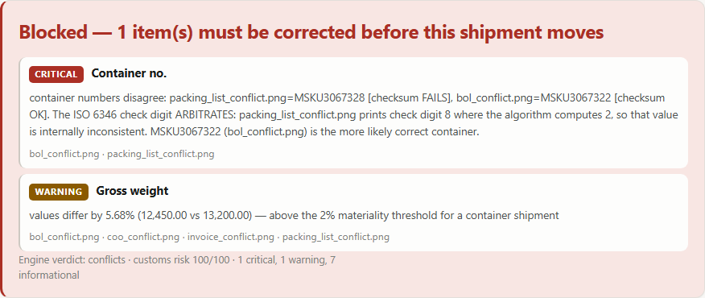
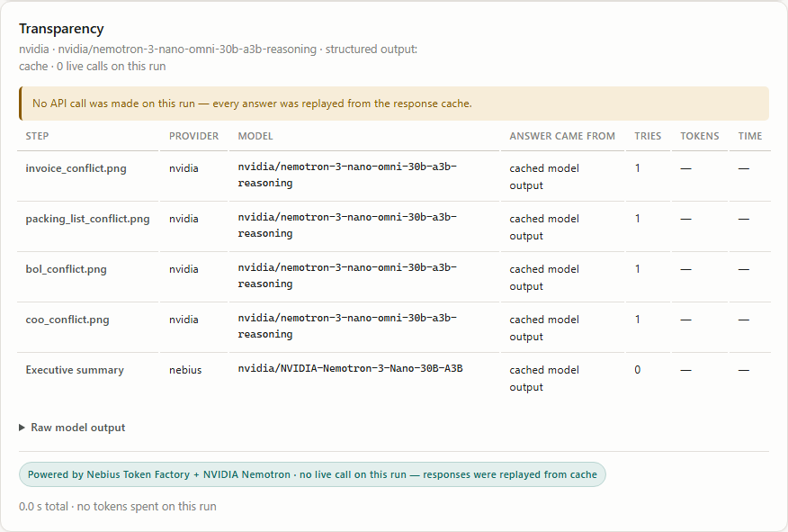
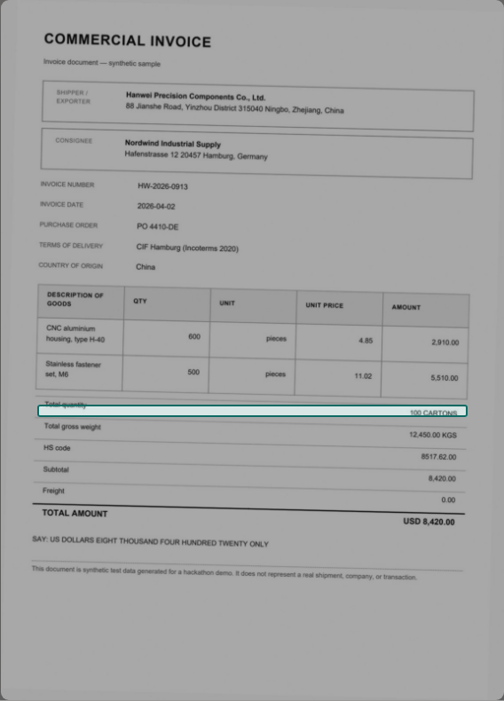

# Shipment Doc Reconciler

<!-- CI badge, live: the workflow runs on push to master. The first run on
     2026-10-23 came back red on a dependency pin, which is exactly what a static
     "CI: passing" badge would have hidden. Observed runs: docs/DEPLOYMENT.md §CI. -->
[](https://github.com/VishnuDev55/shipment-doc-reconciler/actions/workflows/ci.yml)


**One line to know whether a shipment can move.** Drop 2–5 trade documents —
invoice, packing list, bill of lading, certificate of origin — and a vision model
transcribes ten fields from each while deterministic Python decides what agrees.
The model never does arithmetic, converts a currency, or gets to be the verdict.
Every disagreement is quoted back to the printed line it came from, and the result
is a self-contained report (HTML + PDF + ZIP) with correction drafts written by rule.

Built for the **Nebius × NVIDIA Global AI Hackathon**, on two providers, because the
model the brief names is no longer reachable on either of them.

## What it looks like

Three screenshots of `DEMO_MODE` with no key configured — real captured model
output, replayed, and the screen says so. Regenerate them with
`python scripts/make_screenshots.py`.

| A blocked shipment | Who answered what | The evidence, on the page |
|---|---|---|
|  |  |  |
| The check digit arbitrates: `MSKU3067328` fails its own ISO 6346 checksum, so the packing list is the paper that is wrong — no second model call needed to say so. | Four documents read by NVIDIA omni, the summary by Nebius Nemotron, and an amber line stating that zero API calls were made for this run. | The rectangle is measured from the PDF's own text layer, and only ever drawn for a quote that appears verbatim on one printed line. |

## The idea, in one table

A shipment is documented three times by three people, and they disagree. The
interesting part is not reading the documents — it is deciding whether a difference
is an error or a different way of writing the same thing.

| Invoice says | Bill of lading says | Naive diff | This app says |
|---|---|---|---|
| `12,450.00 KGS` | `12.450,00 kg` | conflict | ✓ same — European decimal comma |
| `12,450.00 KGS` | `27,447.00 LBS` | conflict | ✓ same mass — 0.25 kg rounding |
| `1,200 pieces` | `100 cartons` | conflict | ⚠ different package basis, not an error |
| `8517.62.00` | `8517.62.0090` | conflict | ✓ same — HS is harmonized to 6 digits |
| `Nordwind … GmbH` | `Nordwind Industrial Supply` | conflict | ✓ same — legal suffix stripped |
| `MSKU3067322` | `MSKU3067328` | conflict | ❌ conflict, **and it says which one is wrong** |

## How this meets the two hackathon requirements

| Requirement | How it is met |
|---|---|
| **"Runs on Nebius Token Factory"** | Four runtime roles against `https://api.tokenfactory.nebius.com/v1/chat/completions`: the **executive summary** on **`nvidia/NVIDIA-Nemotron-3-Nano-30B-A3B`**, the optional **consensus second reader** and **advisor** on **`openbmb/MiniCPM-V-4_5`**, the **per-document vision fallback**, and — with `VISION_PROVIDER=nebius` — **extraction itself**, measured on both `openbmb/MiniCPM-V-4_5` and `nvidia/Nemotron-3.5-Super-VL`. All four verified live; [`docs/PROVIDERS.md`](docs/PROVIDERS.md) has the per-call evidence. |
| **"Uses at least one NVIDIA open-source model"** | **Document extraction** — the core function — uses **`nvidia/nemotron-3-nano-omni-30b-a3b-reasoning`** via NVIDIA's own `build.nvidia.com` API. Every Nebius model named above is an NVIDIA open model or an explicitly image-capable one; `Nemotron-3.5-Super-VL` is NVIDIA's, hosted by Nebius. |

**Measured, with dates.** The full pipeline ran live on 2026-10-19: omni read
**70/70** fields exact at p50 **59 s** / p95 **67 s** per document, MiniCPM-V
consensus agreed **95.5%** and all five of its divergences were its own invention, at
≈**$0.01** per shipment. `nvidia/Nemotron-3.5-Super-VL` was then tested against a
promotion rule written before the run — 3/3 verdicts, 0 invented fields, exact
≥ 99% — and cleared two of three: **3/3** verdicts and **0** invented across four
passes, but **74/75 (98.7%)** exact where omni is **75/75**. So **omni stays the
default**, Super-VL stays selectable, and no "Nebius-only" preset was added. The
numbers live in
[`fixtures/model_comparison.json`](fixtures/model_comparison.json) and render into
[`docs/EVAL.md`](docs/EVAL.md); the reasoning is in [`SUBMISSION.md`](SUBMISSION.md).

## Quick start

```bash
make setup          # pip install -r requirements.txt
make dev            # http://localhost:8000 — DEMO_MODE, replays the captured cache
```

Click **Clean**, **Conflicts** or **Messy formats**. Those are real document images
pushed through the same pipeline an upload uses, and in demo mode every answer comes
from a committed cache of genuine model output — the header chip and the report both
say so, and `run.live_calls` reads 0.

For live mode, `cp .env.example .env` and fill in **two keys from two places**:
`NVIDIA_API_KEY` from [build.nvidia.com](https://build.nvidia.com/settings/api-keys)
for vision, `NEBIUS_API_KEY` from
[tokenfactory.nebius.com](https://tokenfactory.nebius.com/project/api-keys) for the
summary. `.env` is gitignored and excluded from every archive; only `.env.example`,
with placeholders, is committed. Then `make run`, or paste them into **Configure** in
the UI. Verify both hosts before trusting anything: `make probe-live`.

```bash
make test           # offline suite, zero API calls (the socket guard enforces it)
make e2e            # browser suite: a real uvicorn and real chromium
make check          # lint + ruff + type + test
python scripts/evaluate.py --check    # fail if measured accuracy regresses
docker build -t shipment-doc-reconciler .   # built and smoke-tested in CI
```

## What a run does

1. **Ingest** — EXIF orientation, resize to one long edge, JPEG. A PDF's own text
   layer is recovered here, without OCR and without the model.
2. **Transcribe** — one vision call per document, every page in the same call,
   against a contract that says an absent field reported absent is correct and an
   absent field guessed at is a failure.
3. **Verify the evidence** — each quoted line is checked against the page's own
   text. A value that fails is withdrawn from the comparison and listed, never
   quietly dropped; a page with no text layer is labelled `not_checkable`.
4. **Normalize** — pure functions, one per field kind. `12.450,00` and
   `12,450.00` become one number; `1,200` becomes that number *plus a warning*
   that the convention was ambiguous.
5. **Compare and decide** — tolerances, the cardinality gate, ISO 6346
   arbitration, cross-field sanity, in-document arithmetic, then one severity per
   finding and the banner that follows mechanically from those levels.
6. **Report** — the web view, a standalone HTML, a PDF, a ZIP of the run
   directory, and correction drafts written by rule from the findings.

Every step is deterministic except the transcription, and the transcription is
cached by `sha256(prompt_version + provider + model + page hashes)` — which is why
a demo run costs nothing and a re-run of the same pages is the same report.
Python 3.11 is the container runtime and the version the suite is validated on;
there are no system dependencies to install, because nothing shells out to a
binary.

## Documentation

| Read | For |
|---|---|
| [`docs/ARCHITECTURE.md`](docs/ARCHITECTURE.md) | the shape on one page, the seven invariants, the extraction ladder, the repository layout |
| [`docs/FEATURES.md`](docs/FEATURES.md) | one section per capability: transparency, evidence, severity, consensus, line items, corrections, export |
| [`docs/NORMALIZATION.md`](docs/NORMALIZATION.md) | every rule and threshold that decides whether two printings of a fact agree |
| [`docs/PROVIDERS.md`](docs/PROVIDERS.md) | what NVIDIA and Nebius actually do, measured by calling them |
| [`docs/EVAL.md`](docs/EVAL.md) | measured accuracy, generated from captured model output — and its limits |
| [`docs/PLANTED.md`](docs/PLANTED.md) | the planted-error bundle: what the engine catches, what it does not, the miss declared in advance |
| [`docs/VERIFICATION.md`](docs/VERIFICATION.md) | what each test file covers, and the table of what is *not* verified |
| [`docs/LIVE_FINDINGS.md`](docs/LIVE_FINDINGS.md) | dated live measurements, and the code each one changed |
| [`docs/SECURITY.md`](docs/SECURITY.md) | the threat model, including the four things not protected |
| [`docs/API.md`](docs/API.md) | the HTTP surface, auth contract, curl/Python/JS clients |
| [`docs/DEPLOYMENT.md`](docs/DEPLOYMENT.md) | deploy paths, the container, CI runs observed, health semantics |
| [`docs/adr/`](docs/adr/) | nine decision records, including two reversed by measurement |
| [`docs/AUDIT.md`](docs/AUDIT.md) | what was verified, what is broken, what is deferred, with `file:line` evidence |
| [`CONTRIBUTING.md`](CONTRIBUTING.md) · [`DEMO_SCRIPT.md`](DEMO_SCRIPT.md) | the gates and the rules; ten minutes offline |

## Honest limits

- **Every accuracy number here is measured on synthetic documents this repo wrote**
  — twelve demo pages and a 19-case planted bundle whose ground truth was declared
  before anything ran. That is what makes them comparable, and it is their ceiling:
  nothing here measures a scan of somebody's real packing list.
- **Model invention is the failure the architecture cannot catch.** MiniCPM-V
  asserted four values its pages do not print, and those manufactured a disagreement
  the paperwork does not contain — the engine surfaces it, it does not detect it.
  Tightening the prompt did not change it.
- **On a photo or a scan, invention is undetectable by code in this build.** There is
  no text layer to check a quote against, so those fields are labelled
  `not_checkable` rather than implied verified.
- **No omni number exists for the German, French or phone-photo cases.** Those three
  are measured on Nebius MiniCPM-V only; the default model hung past the deadline on
  each, so "not measured" is the wording — not a comparison, and not evidence of
  weakness either way. The German and French pages are also synthetic, drawn by
  `scripts/build_stress_inputs.py`.
- **The brief's exact model is unavailable**: `nvidia/nemotron-nano-12b-v2-vl`
  returns 410 Gone on build.nvidia.com and 404 on Token Factory. The substitution and
  its reasoning are in [`docs/PROVIDERS.md`](docs/PROVIDERS.md).
- **Goods lines have never been read by a live model.** The plumbing is tested and
  provably cannot move a verdict; in demo mode the section reports `skipped` rather
  than showing an empty table.
- **The public deployment is capped, and the cap is per container.** `render.yaml`
  sets a $2/day ceiling from the spend ledger, 3 documents and 4 pages per
  upload, and a 24-hour run retention. On a free instance the ledger lives on
  an ephemeral volume, so a redeploy resets the day; the page says so.
- **No hosted instance is deployed.** The container builds and CI proves it; a public
  URL does not exist yet, and nothing in this repo claims one.
- **mypy is a baseline, not a gate**: 8 errors in 3 files, named in
  `pyproject.toml`, and CI fails if the number grows.

## License

MIT.
